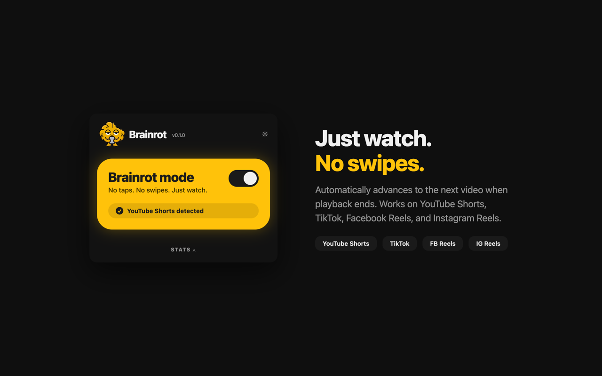
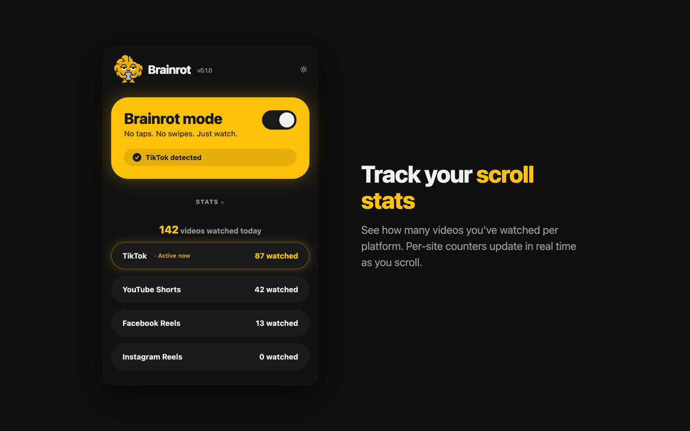

<p align="center">
  
</p>

# Brainrot - Auto Scroll for Shorts & Reels

Brainrot automatically scrolls short-form videos so you can watch hands-free.

No tapping. No swiping. Just watch.

## Supported sites

- YouTube Shorts
- TikTok
- Facebook Reels
- Instagram Reels

## Screenshots

<p align="center">
  
</p>

<p align="center">
  
</p>

## How it works

Brainrot detects when a video is about to end and automatically moves to the next one. It works seamlessly inside each platform -- no interruptions, no setup.

Just open a supported feed and turn on Brainrot mode.

## Features

- **Auto-advance** -- moves to the next video when the current one finishes
- **Smart timing** -- triggers at end of playback (within 0.25s)
- **Per-platform stats** -- tracks how many videos you've watched on each site
- **One-click toggle** -- enable/disable Brainrot mode from the popup
- **Dark mode** -- light/dark theme toggle
- **SPA-aware** -- survives in-app navigation on single-page sites
- **Cross-browser** -- Chrome, Edge, Brave, Firefox, and Safari

## Getting started

1. Open YouTube Shorts, TikTok, or Reels
2. Click the Brainrot extension
3. Turn on Brainrot mode
4. Sit back and watch

## Install

### Chrome / Edge / Brave

1. `pnpm install && pnpm build`
2. Open `chrome://extensions`, enable **Developer mode**
3. Click **Load unpacked** and select `dist/chromium/`

### Firefox

1. `pnpm install && pnpm build`
2. `pnpm firefox:run` -- or load `dist/firefox/` as a temporary add-on in `about:debugging`

### Safari (macOS)

Requires Xcode.

```bash
pnpm install
pnpm safari:run
```

## Development

```bash
pnpm install
pnpm build              # Full build (Chromium + Firefox + Safari)
pnpm build:base         # Vite only (no browser packaging)
pnpm test               # Run all tests
pnpm test:watch         # Watch mode
pnpm typecheck          # Type-check without emitting
```

## Adding a new site

1. Create a `FeedSiteAdapter` in `src/sites/`
2. Export a named adapter
3. Register it in `DEFAULT_FEED_SITES` in `src/core/feed-engine.ts`
4. Add match patterns to `manifest.json` (and `manifest.firefox.json` if needed)

## Project structure

```
src/
  content/        Content script entry point + runtime settings
  core/           Feed engine (site-agnostic auto-advance logic)
  sites/          Per-site adapters (YouTube, TikTok, Facebook, Instagram)
  popup/          Extension popup UI (code-generated HTML)
  background/     Service worker
  shared/         Shared utilities, settings, DOM helpers
scripts/          Build & packaging scripts
tests/            Vitest test suite
```

## Privacy

Brainrot does not collect personal data. All settings are stored locally in your browser.

## License

Apache 2.0
